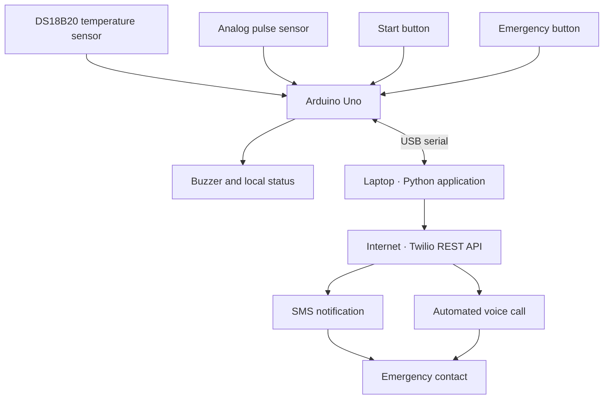

# Smart Healthcare Monitoring System with Emergency Call Alert

A laptop-connected healthcare-monitoring prototype built with **Arduino Uno, DS18B20, an analog pulse sensor, Python, and Twilio**. The Arduino acquires sensor data and applies local threshold logic; Python receives serial status messages and uses the Twilio cloud API to send SMS notifications and place automated voice calls.

> **Safety notice:** This is an educational prototype, not a medical device. Its readings and thresholds are not clinically validated and must not be used for diagnosis, treatment, or emergency-care decisions.

## System block diagram



## Features

- Temperature measurement using a DS18B20 digital sensor.
- Analog pulse-sensor sampling (five samples averaged in the current sketch).
- Start/stop monitoring and manual emergency controls.
- Local buzzer feedback and automatic emergency state on configured abnormal readings.
- USB serial communication from Arduino Uno to a laptop.
- Python serial listener integrated with Twilio SMS and voice-call APIs.
- Alert de-duplication so one continuous emergency state does not repeatedly trigger calls.

## Thresholds in this prototype

| Parameter | Configured rule |
|---|---|
| Temperature | 40.0 °C or above is flagged abnormal |
| Pulse estimate | Below 50 or above 120 BPM is flagged abnormal |

These are demonstration thresholds only. The current pulse conversion is a simple analog-value mapping, **not a validated heart-rate detection algorithm**. The device does not establish a clinically reliable BPM measurement.

## Hardware

- Arduino Uno
- DS18B20 temperature sensor
- 4.7 kΩ pull-up resistor for DS18B20 data line
- Analog pulse sensor module
- Two momentary push buttons (Start and Emergency)
- Buzzer
- Breadboard, jumper wires and USB cable
- Laptop with Python and internet access

See [hardware/components.md](hardware/components.md) and [hardware/wiring.md](hardware/wiring.md).

## Software

- Arduino IDE
- Arduino libraries: OneWire and DallasTemperature
- Python 3
- pySerial
- Twilio Python helper library

## Repository layout

```text
src/
  arduino/healthcare_monitor.ino
  python/main.py
  python/requirements.txt
  python/config.example.env
hardware/
  components.md
  wiring.md
  block-diagram.md
docs/
  algorithm.md
  system-architecture.md
  design-decisions.md
  testing.md
  limitations.md
  ai-disclosure.md
media/README.md
```

## Setup

### 1. Upload the Arduino sketch

1. Install the Arduino IDE.
2. Install **OneWire** and **DallasTemperature** from Library Manager.
3. Connect the Arduino Uno and select the correct board and COM port.
4. Open `src/arduino/healthcare_monitor.ino`, compile and upload.
5. Close Arduino Serial Monitor before running Python because a serial port is normally exclusive.

### 2. Configure Python

From `src/python`:

```bash
python -m pip install -r requirements.txt
```

Copy `config.example.env` to `.env` and fill in your own values:

- `SERIAL_PORT`: the Arduino COM port (for example, COM5 on Windows).
- `TWILIO_ACCOUNT_SID`
- `TWILIO_AUTH_TOKEN`
- `TWILIO_FROM_NUMBER`
- `ALERT_TO_NUMBER`

Never commit `.env`, account credentials, phone numbers, or API tokens. The example file contains placeholders only. If a credential has been exposed, rotate it in the Twilio Console.

Run:

```bash
python main.py
```

Twilio trial accounts can impose verified-recipient and trial-message restrictions. Confirm the current rules in your Twilio Console.

## Serial protocol

The Arduino sends plain-text status lines. The Python application reacts to:

- `STARTED`, `STOPPED`
- `EMERGENCY_BUTTON`
- `STATUS:NORMAL`
- `STATUS:ABNORMAL_TEMP`
- `STATUS:ABNORMAL_HR`
- `RESET`

Human-readable measurement lines are printed for monitoring and debugging.

## Testing

Follow [docs/testing.md](docs/testing.md). Test with safe simulated conditions and a test recipient before any demonstration. Do not deliberately induce a medical emergency or rely on this prototype for real patient care.

## Contributions and AI disclosure

The project concept, hardware selection, physical assembly, wiring, hands-on testing, threshold choices, and integration decisions were developed and performed by the project author. AI assistance was used for code structuring/debugging guidance and for preparing documentation and repository organization. See [docs/ai-disclosure.md](docs/ai-disclosure.md) for a fuller distinction.

## License

The repository's existing [LICENSE](LICENSE) file is retained. Review its terms before reuse or redistribution.
